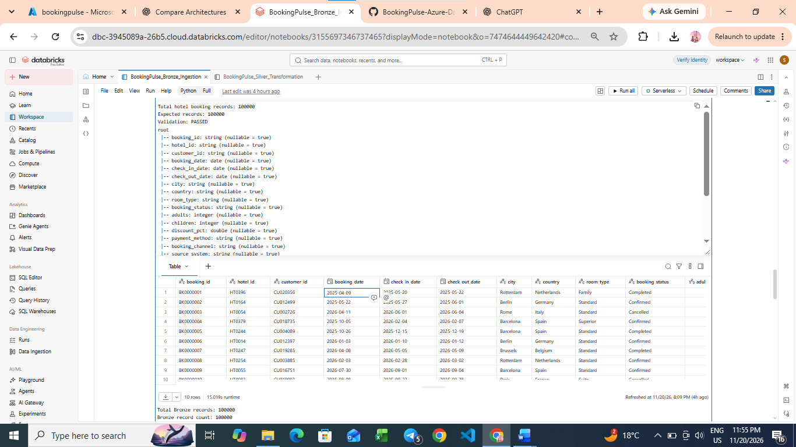
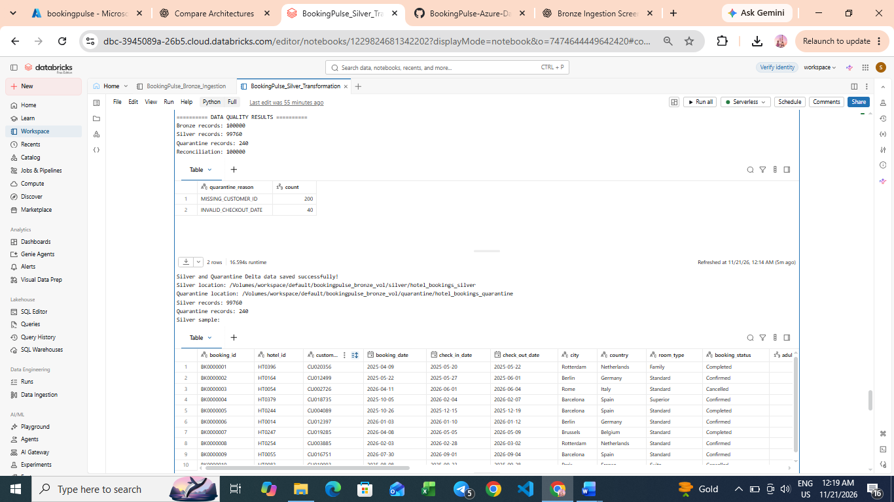
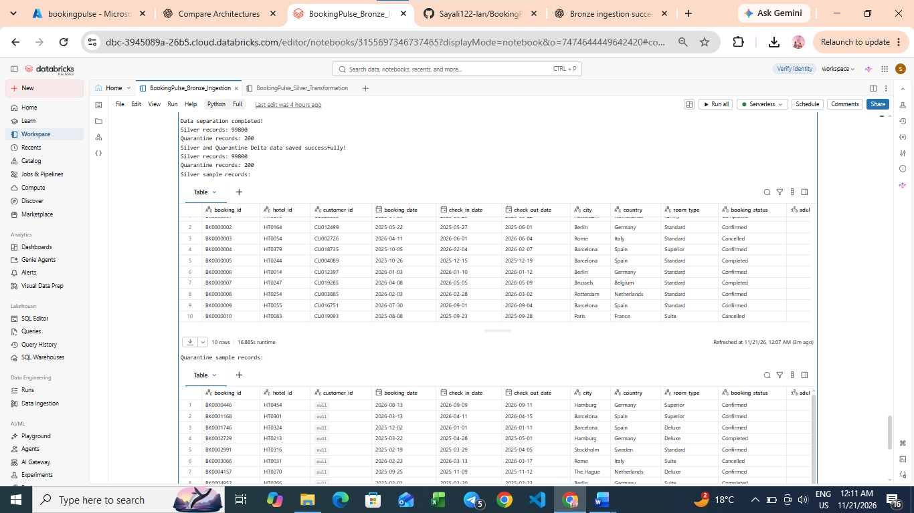
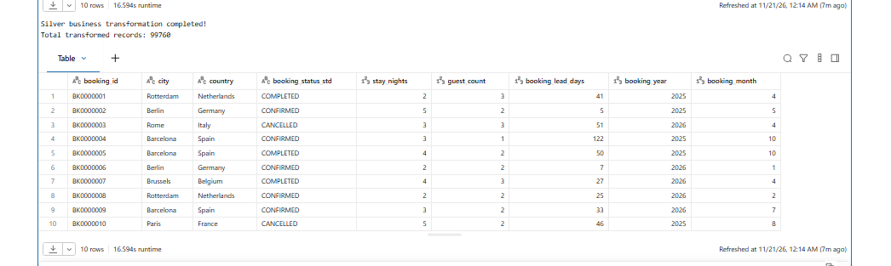
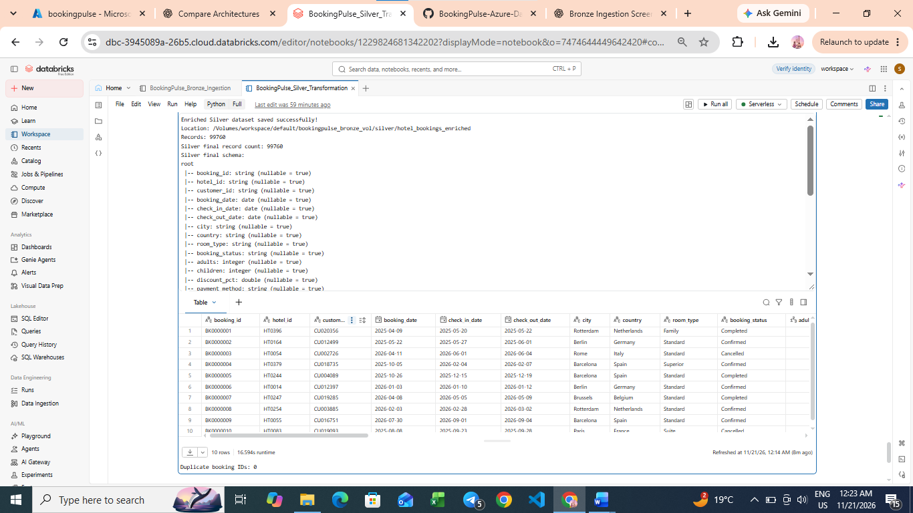

# BookingPulse Azure – Hotel Data Engineering Platform

An end-to-end hotel booking data engineering platform demonstrating scalable data ingestion, data quality validation, data transformation and analytics-ready data modelling.

## Project Overview

BookingPulse is a portfolio-grade data engineering project designed to process hotel booking information and transform raw booking records into reliable, analytics-ready datasets.

The project uses PySpark and Delta Lake in Azure Databricks, with a Medallion Architecture approach consisting of Bronze, Silver and Gold layers.

**Dataset:** 100,000 hotel booking records.

## Architecture

```text
Hotel Booking CSV
       |
       v
Databricks PySpark Ingestion
       |
       v
   BRONZE LAYER
 Raw Delta Storage
       |
       v
 Data Quality Validation
       |
       +-------------------+
       |                   |
       v                   v
  SILVER LAYER        QUARANTINE
 Cleaned and          Invalid Records
 Enriched Data
       |
       v
    GOLD LAYER
 Fact and Dimension Tables
       |
       v
    Power BI
  (Planned)
```

## Technology Stack

| Technology | Purpose |
|---|---|
| Azure Databricks | Distributed data processing |
| PySpark | Data ingestion and transformations |
| Delta Lake | Reliable data storage |
| Databricks Volumes | Dataset and layer storage |
| Python | Data engineering logic |
| GitHub | Source control and documentation |
| Azure Data Factory | Planned orchestration |
| Power BI | Planned analytics and reporting |

## Project Implementation

### 1. Bronze Layer – Data Ingestion

- Ingested hotel booking CSV data using PySpark.
- Loaded 100,000 booking records.
- Performed record count validation.
- Saved raw data in Delta format.
- Verified Bronze Delta storage.

**Execution Result:**
- Total records: 100,000
- Validation: PASSED

### 2. Silver Layer – Data Quality and Transformation

Implemented data quality checks and business transformations.

**Data Quality Checks**
- Null value analysis.
- Duplicate booking ID validation.
- Missing customer ID identification.
- Invalid checkout date identification.
- Data reconciliation.

**Quarantine Handling**

Invalid records are separated from valid records for controlled data quality management.

| Metric | Records |
|---|---:|
| Bronze Records | 100,000 |
| Silver Records | 99,760 |
| Quarantined Records | 240 |
| Missing Customer ID | 200 |
| Invalid Checkout Date | 40 |

**Business Transformations**

Created additional business columns:

- stay_nights
- guest_count
- booking_lead_days
- booking_year
- booking_month

Saved the enriched Silver dataset in Delta format.

### 3. Gold Layer – Dimensional Modelling

Planned implementation:

- dim_date
- dim_hotel
- dim_customer
- dim_room
- fact_bookings

The Gold layer will support business intelligence and hotel booking analytics.

## Execution Evidence

The following screenshots demonstrate actual notebook execution and validation results.

### Bronze Layer



### Data Quality Validation



### Silver Quarantine Results



### Silver Business Transformations



### Silver Delta Verification



## Repository Structure

```text
BookingPulse-Azure-Data-Engineering/
|
|-- notebooks/
|   |-- BookingPulse_Bronze_Ingestion.py
|   |-- BookingPulse_Silver_Transformation.py
|
|-- screenshots/
|   |-- README.md
|   |-- bronze_ingestion_success.png
|   |-- data_quality_validation.png
|   |-- silver_quarantine_results.png
|   |-- silver_business_transformations.png
|   |-- silver_delta_verification.png
|
|-- README.md
|-- LICENSE
|-- .gitignore
```

## Business Use Cases

The platform is designed to support:

- Hotel booking performance analysis.
- Revenue analysis.
- Monthly booking trends.
- Hotel and country-level comparisons.
- Booking cancellation analysis.
- Customer booking behaviour.

## Project Status

| Component | Status |
|---|---|
| Bronze ingestion | Completed |
| Bronze Delta storage | Completed |
| Data quality validation | Completed |
| Quarantine handling | Completed |
| Silver transformations | Completed |
| Silver Delta verification | Completed |
| Gold dimensional modelling | In progress |
| Azure Data Factory orchestration | Planned |
| Power BI dashboard | Planned |

## Author

Developed as an independent portfolio project to demonstrate practical Azure Data Engineering, PySpark, Delta Lake and data quality engineering skills.

**GitHub Repository:**  
https://github.com/Sayali122-lan/BookingPulse-Azure-Data-Engineering
